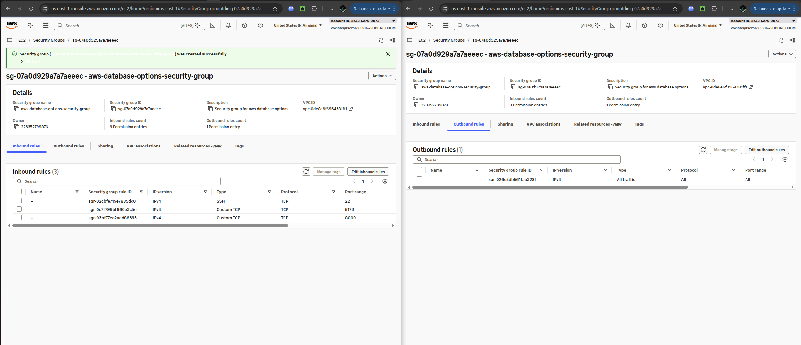
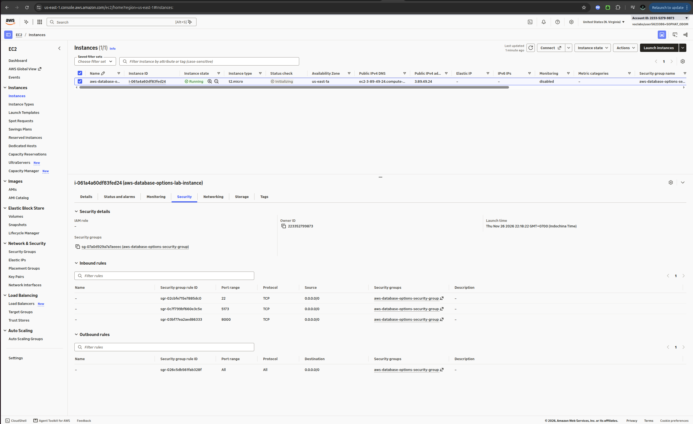
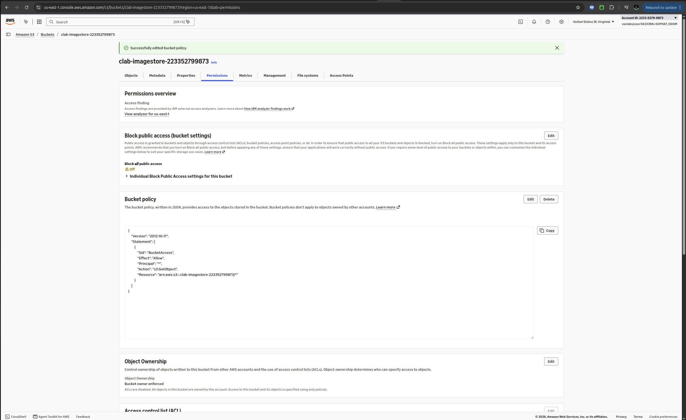
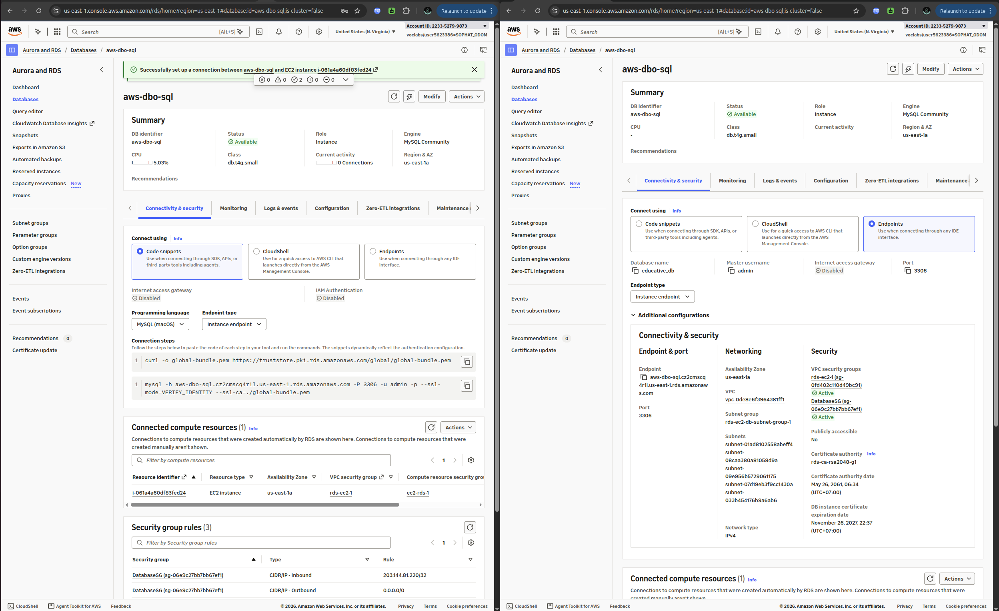
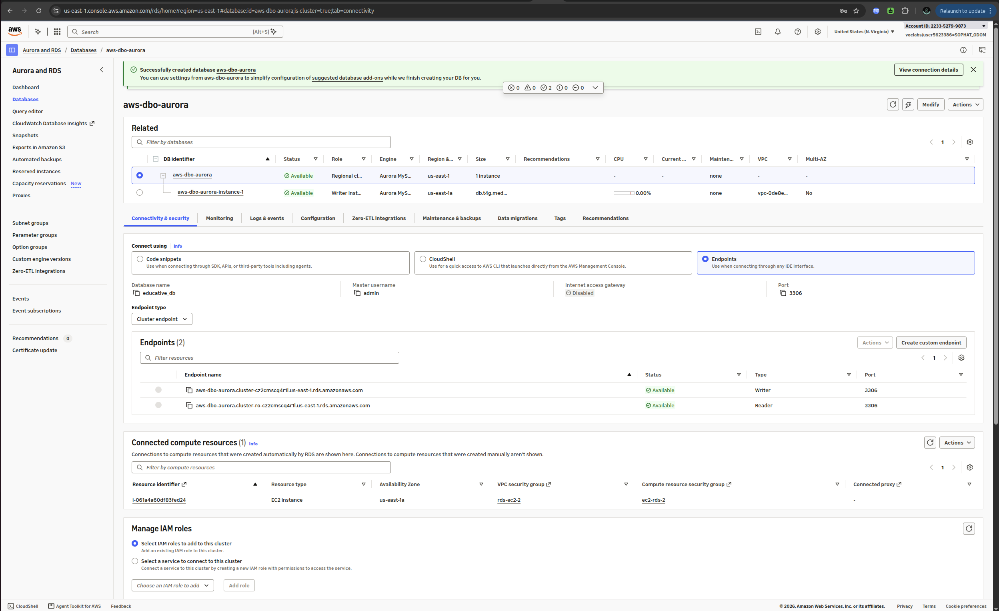
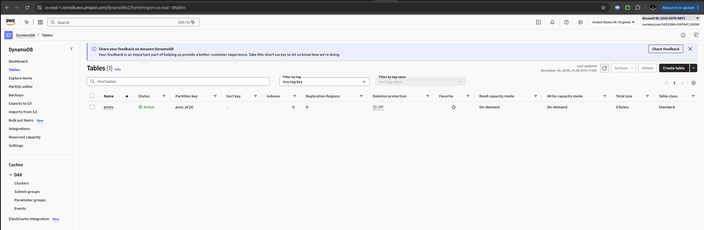
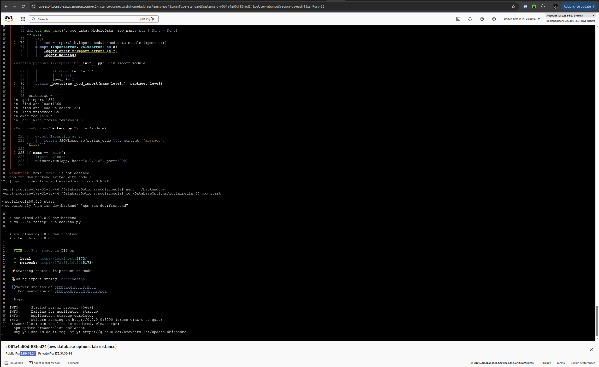
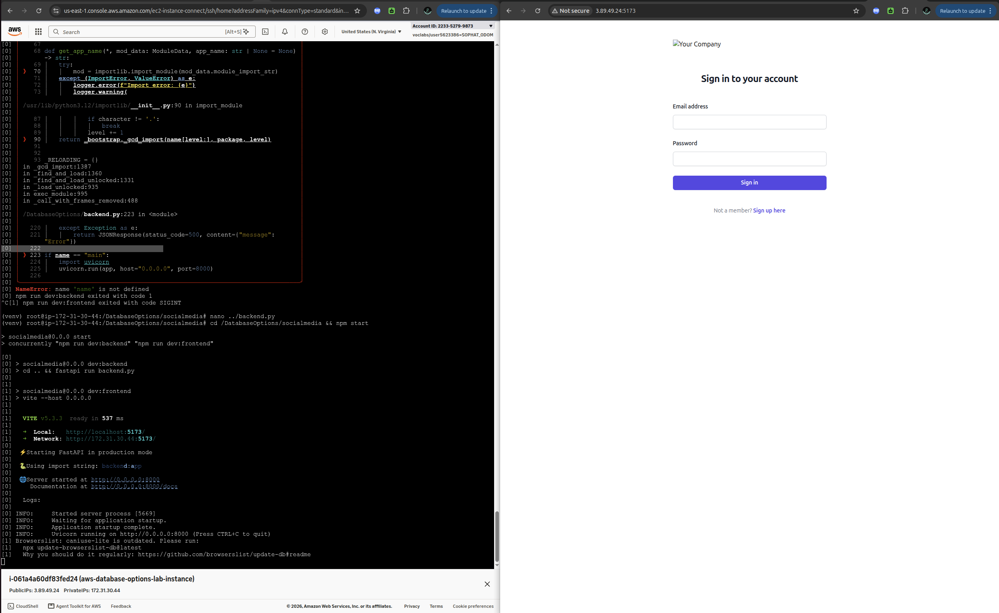
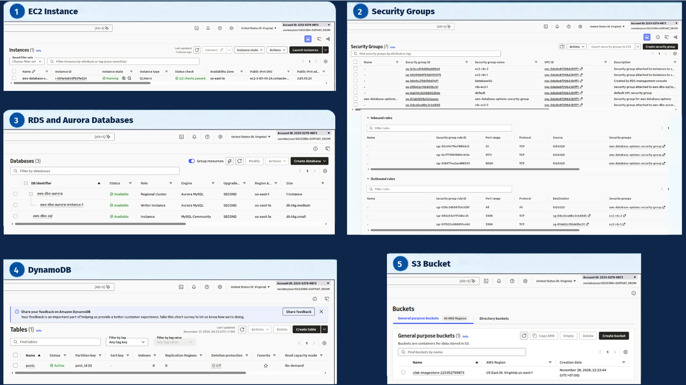
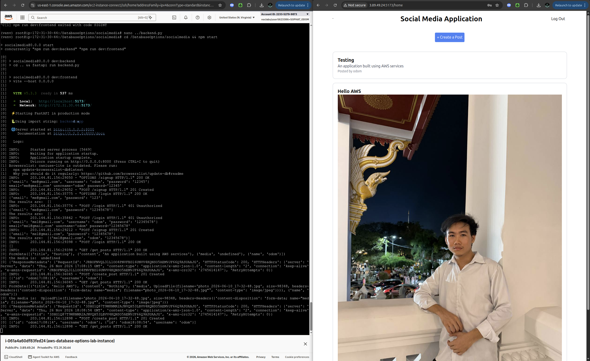

# Cloud Lab 5 Submission — AWS Database Lab

- **Student name:** Sophat Odom
- **Student ID:** e20221559
- **Learner Lab user name:** Sophat Odom
- **Date completed:** 27 Nov 2026

---

## 1. Security Group Rules

`aws-database-options-security-group` with its inbound rules (SSH port 22, Custom TCP ports 8000 and 5173) and its outbound rule.

## 2. EC2 Instance Running

`aws-database-options-lab-instance` in the **Running** state with `aws-database-options-security-group` attached.

## 3. S3 Bucket

Your `clab-imagestore-…` bucket with its public access settings and bucket policy visible.

## 4. RDS DB Instance

`aws-dbo-sql` with the status **Available** and its endpoint visible.

## 5. Aurora DB Status

The `aws-dbo-aurora` cluster with the status **Available** and its writer and reader endpoints visible.

## 6. DynamoDB Table

The `posts` table with the status **Active** and its partition key `post_id` visible.

## 7. Application Configuration and Testing

The EC2 instance terminal after `npm start`, showing that the application started.

The application running in your browser at `http://<Public_IP_of_EC2>:5173`, with the address bar visible.

## 8. Final Infrastructure

One collage of the resources you created: EC2 instance, security group, RDS and Aurora databases, DynamoDB table and S3 bucket.

## Signup and Sample Post (optional)

The signup or login page and a sample post. Delete this section if you did not take this screenshot.

## Errors and troubleshooting (optional)

Screenshots of any error messages you met, and what you did about them.

- As the screenshot 07-app-start has shown, the error is with name == 'main' as there is no __ __ surrounded the name and main. So I just add it to both of them and start again.

---

## Questions

1. Signup writes to the Aurora **writer** endpoint and login reads from the **reader** endpoint. Your cluster has no Aurora Replica. Which instance answers the reader endpoint, and why does the application still work?
- Since the Aurora cluster has no replica, the **writer** instance also handles requests from the **reader** endpoint. The application still works because the **writer** supports both read and write operations.
2. A post is split between the `user_post` table in RDS and the `posts` table in DynamoDB. What does each one store, and how does `/get_posts` join them?
- The `user_post` table in RDS stores `id` and `username`, while the `posts` table in DynamoDB stores `post_id`, `title`, `content`, and an optional `media` URL. The `/get_posts` endpoint retrieves metadata from RDS, fetches the matching content from DynamoDB using the post ID, combines them, and returns the list of posts.
3. The post ID is the username followed by the time (`%H:%M:%S`). What happens if the same user publishes two posts in the same second, or on two different days at the same time?
- Both posts would have the same ID because the timestamp only contains hours, minutes, and seconds. Since id is a primary key in RDS, the second post would cause a duplicate primary key error, and the application would return a 500 error without saving the second post to DynamoDB.
4. Why does the post content go into DynamoDB instead of a SQL table, according to the lab's database design?
- DynamoDB is used because post data can vary. Some posts contain media while others do not. Its flexible schema allows posts to have different attributes without requiring a fixed table structure.
5. The `users` table stores the password exactly as the user typed it, and the S3 bucket allows anyone to read its objects. Name one risk of each choice.
- **Plain-text passwords:** Attackers could directly read users' passwords if the database is compromised.
- **Public S3 bucket:** Anyone could access uploaded media files, potentially exposing private or sensitive content.

## Clean up

- [x] EC2 instance terminated and `aws-database-options-security-group` deleted.
- [x] RDS instance `aws-dbo-sql` and Aurora cluster `aws-dbo-aurora` deleted.
- [x] S3 bucket emptied and deleted.
- [x] DynamoDB table `posts` deleted.