# Cloud Lab 4 Submission — Amazon VPC

Copy this template to `cc-lab-YOUR_ID/lab4/README.md` in your own repository. Follow [the instructions](lab4-instruction.md). Put your screenshots in `lab4/images/` with the file names below.

- **Student name:**
- **Student ID:**
- **Learner Lab user name:**
- **Date completed:**

---

## VPC and internet gateway

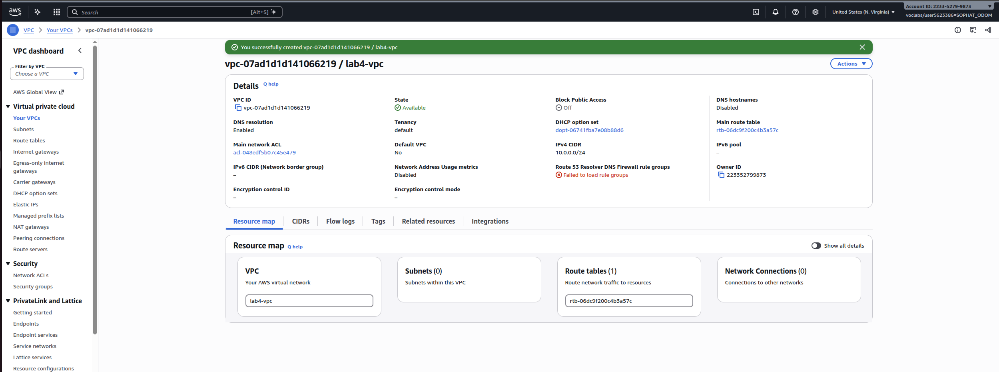

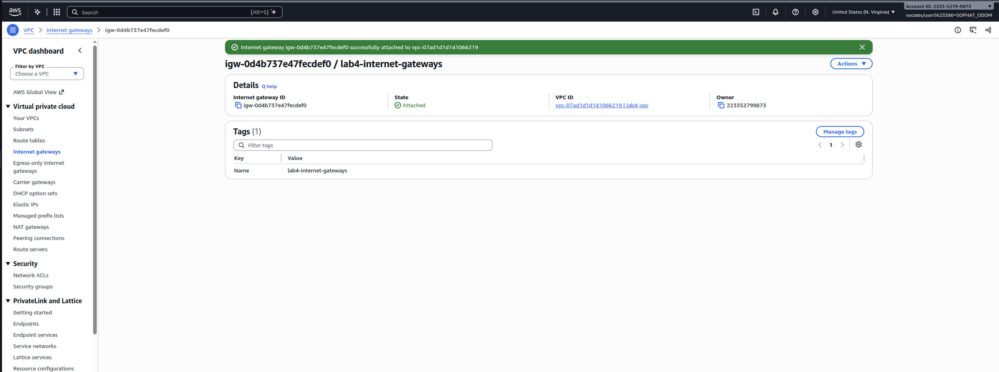

## Public subnet

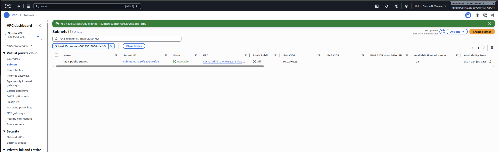

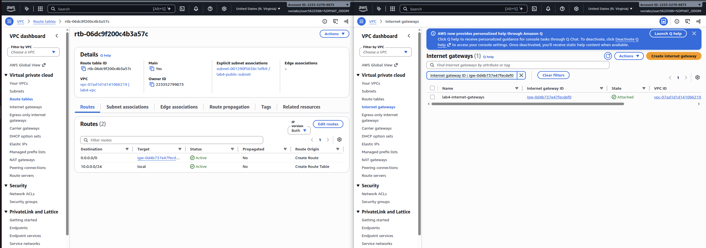

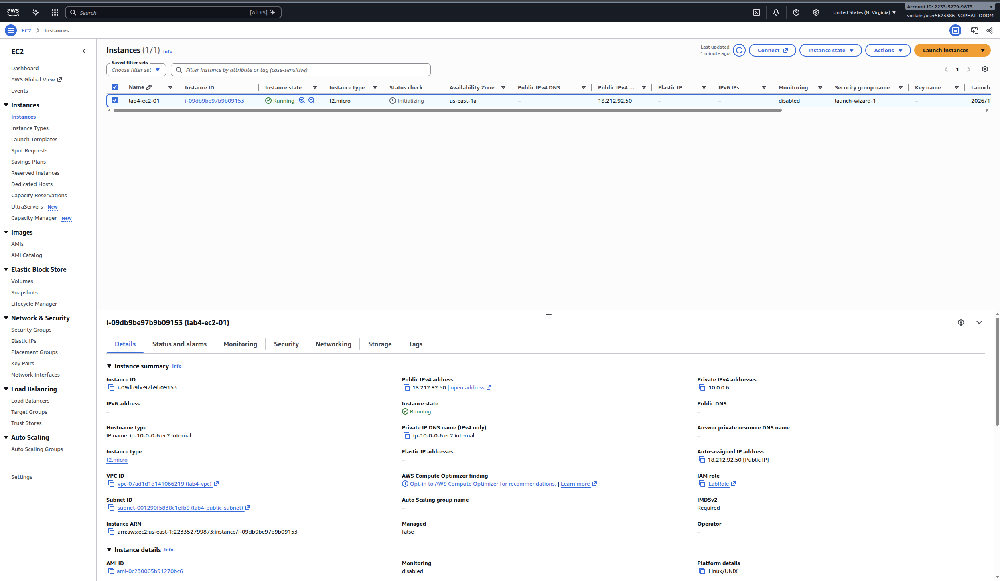

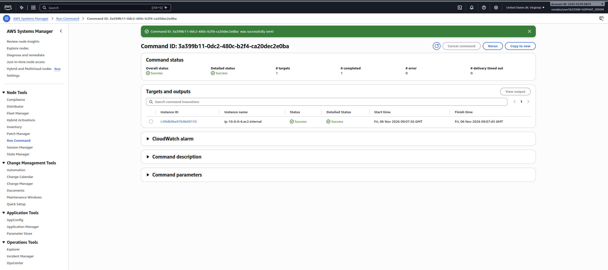

## Private subnet

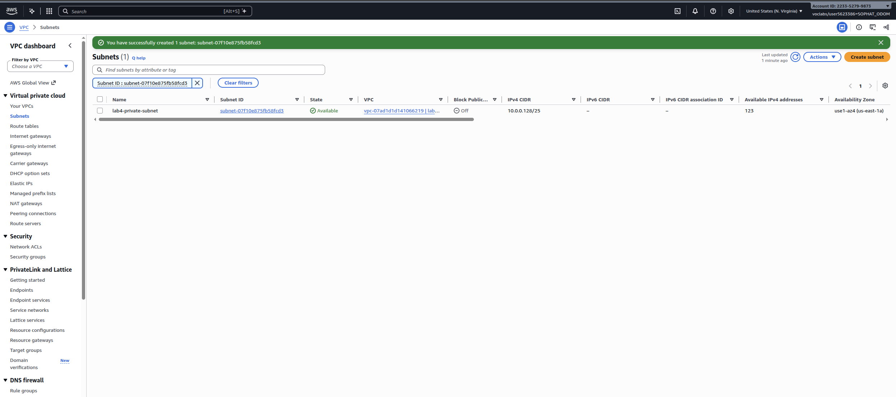

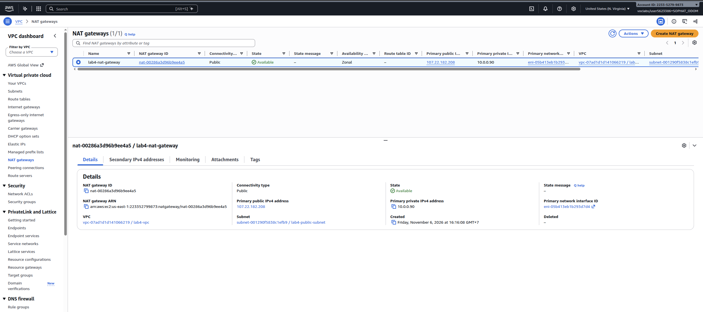

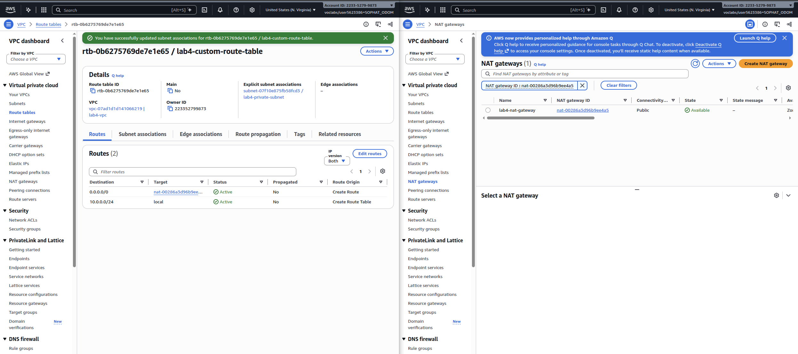

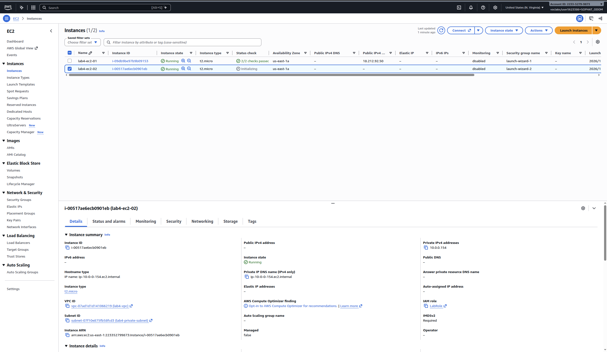

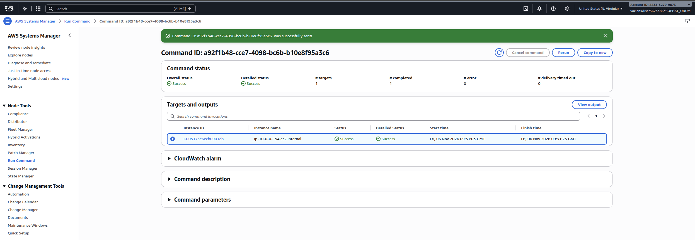

---

## Questions

1. The VPC is `10.0.0.0/24` and the subnets are `10.0.0.0/25` and `10.0.0.128/25`. How many IP addresses does each block contain, and why do the two subnets not overlap?
- **`10.0.0.0/24` (VPC):** Contains **256 IP addresses** ($2^{32-24} = 2^8 = 256$), ranging from `10.0.0.0` to `10.0.0.255`.
- **`10.0.0.0/25` and `10.0.0.128/25` (Subnets):** Each contains **128 IP addresses** ($2^{32-25} = 2^7 = 128$). *(AWS reserves 5 IP addresses in each subnet, leaving 123 usable IPs per subnet).*
- **Why they do not overlap:** Extending the prefix from `/24` to `/25` borrows 1 bit from the host portion, splitting the 256-address block into two equal halves. The first subnet (`10.0.0.0/25`) covers `10.0.0.0` to `10.0.0.127`, and the second subnet (`10.0.0.128/25`) starts immediately after at `10.0.0.128` and covers up to `10.0.0.255`.
2. Both subnets are in the same VPC. What exactly makes `lab4-public-subnet` public and `lab4-private-subnet` private?
- `lab4-public-subnet` is **public** because its route table has a direct route (`0.0.0.0/0`) pointing to the **Internet Gateway (`lab4-internet-gateway`)**, which allows instances with public IPs to send and receive traffic directly to and from the internet.
- `lab4-private-subnet` is **private** because its route table (`lab4-custom-route-table`) does not have a direct route to the Internet Gateway; instead, it routes `0.0.0.0/0` traffic to the **NAT Gateway (`lab4-nat-gateway`)**.
3. Why is the NAT gateway placed in the **public** subnet and not in the private one?
- A NAT gateway needs to forward traffic from the private subnet out to the internet and return the responses. To reach the internet, the NAT gateway itself requires an Elastic IP (public IP) and a route to the **Internet Gateway**. Only the **public subnet** has a route table pointing to the Internet Gateway—if the NAT gateway were placed in the private subnet, it would have no path to the internet.
4. `lab4-ec2-02` has no public IP address. Can someone on the internet open a connection to it? Can it download updates? Explain both answers.
- **Can someone on the internet open a connection to it?** **No.** Because `lab4-ec2-02` has no public IP address and sits in a private subnet behind a NAT gateway (which only supports outbound-initiated connections), external users on the internet have no public address or route to initiate an inbound connection to it.
- **Can it download updates?** **Yes.** When `lab4-ec2-02` initiates an outbound request (`sudo yum update -y`), its route table sends the traffic to the **NAT gateway** in the public subnet. The NAT gateway translates the instance's private IP to its own Elastic IP, forwards the request to the internet via the Internet Gateway, and sends the downloaded update packages back to `lab4-ec2-02`.
5. You tested internet access with Systems Manager instead of SSH. Why did the instances need `LabInstanceProfile` for this?
- By default, an EC2 instance does not have permission to call AWS APIs. The SSM Agent running on the EC2 instance needs IAM permissions to register with AWS Systems Manager and receive commands. Attaching `LabInstanceProfile` (which contains the `LabRole` IAM role) grants the instance the required authorization to communicate with Systems Manager so commands can be run remotely without SSH keys or inbound security group rules.  

## Problems and how I solved them (optional)

## AI note (optional)

One suggestion an AI tool gave you and how you checked it.

## Clean up

- [x] Instances terminated.
- [x] NAT gateway deleted and its Elastic IP released.
- [x] Internet gateway detached and deleted.
- [x] `lab4-vpc` deleted.
