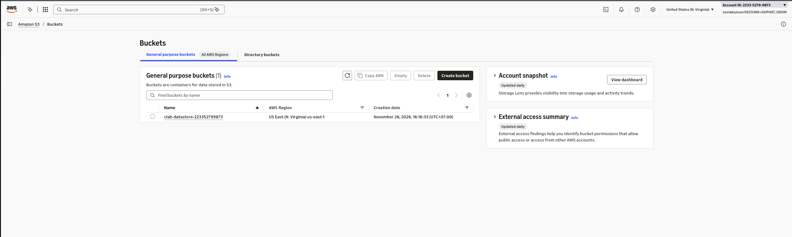
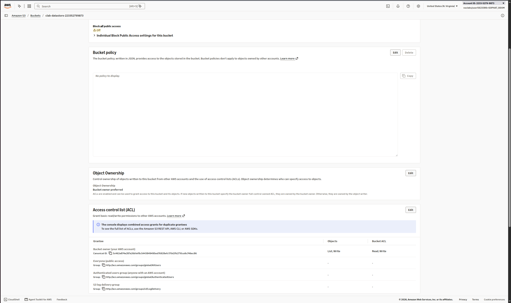
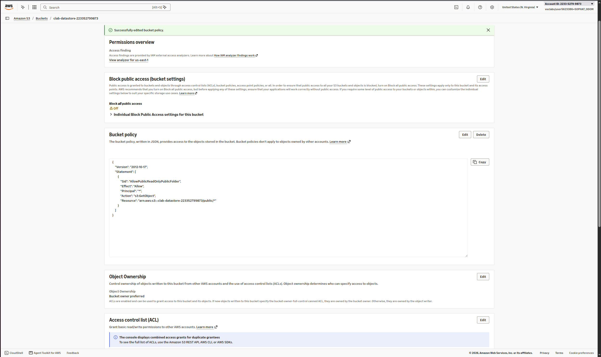
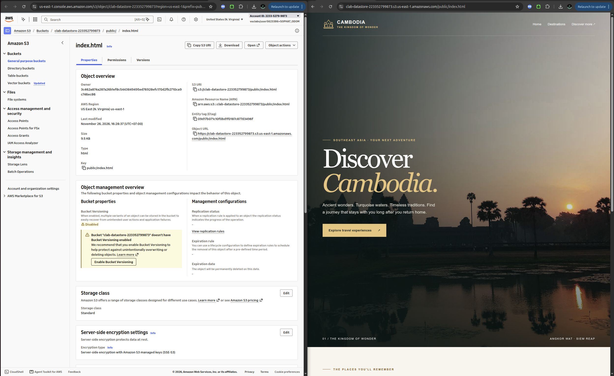
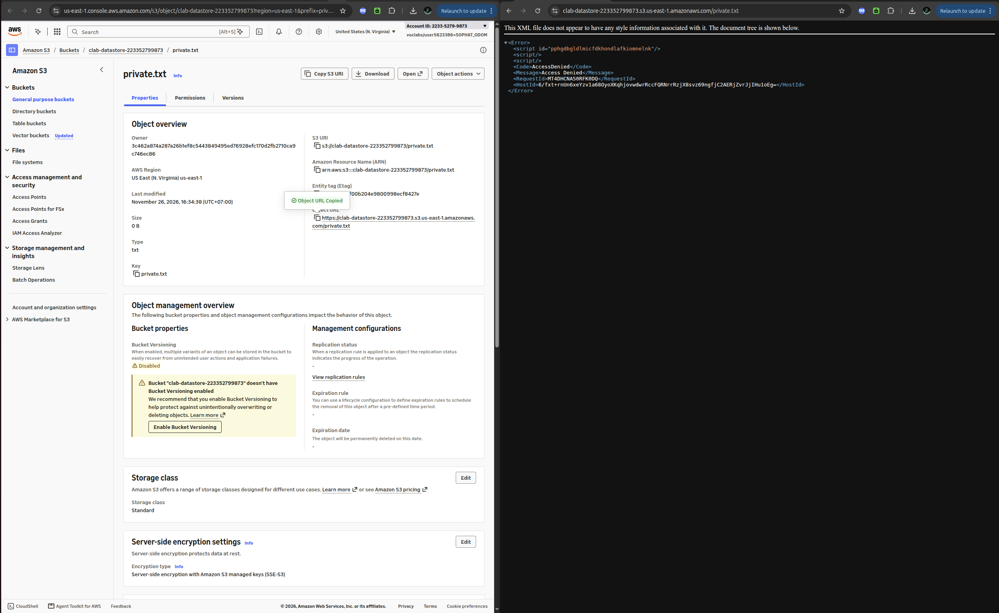
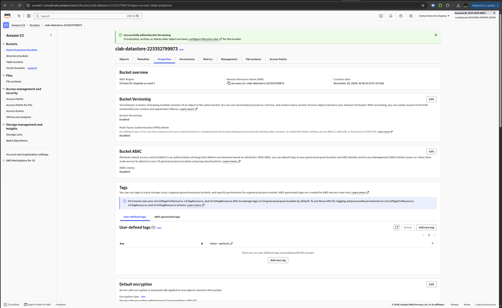
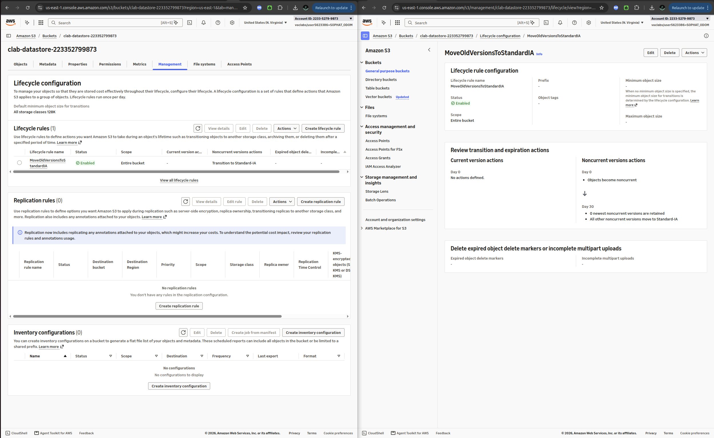

# Cloud Lab 3 Challenge Submission — Secure S3 Bucket

- **Student name:** Sophat Odom
- **Student ID:** e20221559
- **Learner Lab user name:** Sophat Odom
- **Bucket name:** clab-datastore-223352799873
- **Date completed:** 26 Nov 2026

---

## 1. Bucket

## 2. Object ownership

## 3. Public access policy

My policy is in [bucket-policy.json](bucket-policy.json). Explain which line limits public access to the `public/` folder:

## 4. Versioning

## 5. Lifecycle rule

---

## Questions

1. You turned off parts of **Block Public Access** for this bucket. Why was that needed, and why is it still safe for the objects outside `public/`?
- We turned off parts of **Block Public Access** to allow the bucket policy to grant public read access. It is still safe because the policy only allows access to objects inside `public/`, while public access through ACLs remains blocked.
2. What is a **noncurrent version**? Give an example from your own test.
- A **noncurrent version** is an older version of an object that is kept after the object is updated or overwritten. For example, when I update and upload index.html again, the previous version becomes noncurrent.
3. Why move noncurrent versions to S3 Standard-IA instead of deleting them?
- Moving noncurrent versions to S3 Standard-IA reduces storage costs while keeping the older versions available for recovery if needed.

## AI note (optional)

One suggestion an AI tool gave you and how you checked it.

## Clean up

- [x] All object versions deleted and the bucket deleted.