# Cloud Lab 2 Submission — Load Balancer and Auto Scaling

Copy this template to `cc-lab-YOUR_ID/lab2/README.md` in your own repository. Follow [the instructions](lab2-instruction.md). Put your screenshots in `lab2/images/` with the file names below.

- **Student name:** Sophat Odom
- **Student ID:** e20221559
- **Learner Lab user name:** Sophat Odom
- **Date completed:** Fri 30 Oct 2026

---

## Security groups

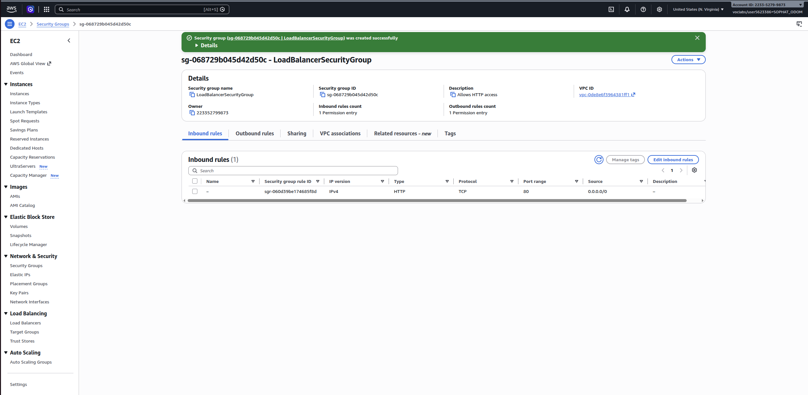

## Target group

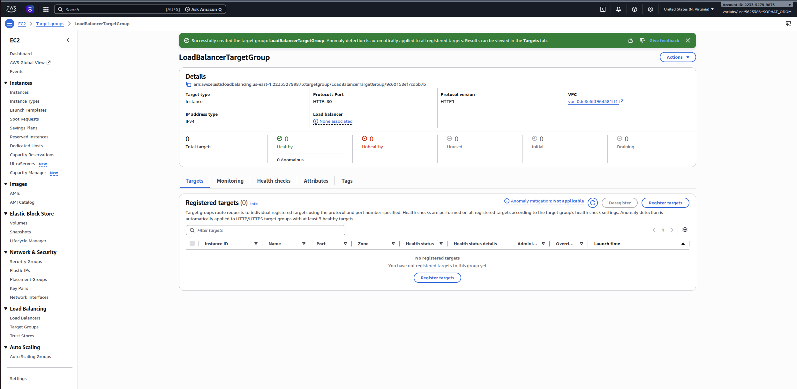

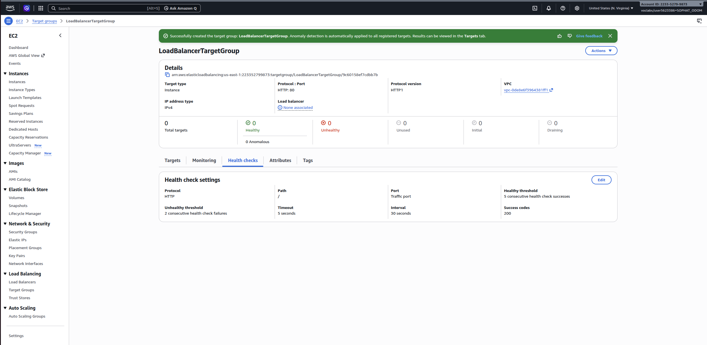

## Application Load Balancer

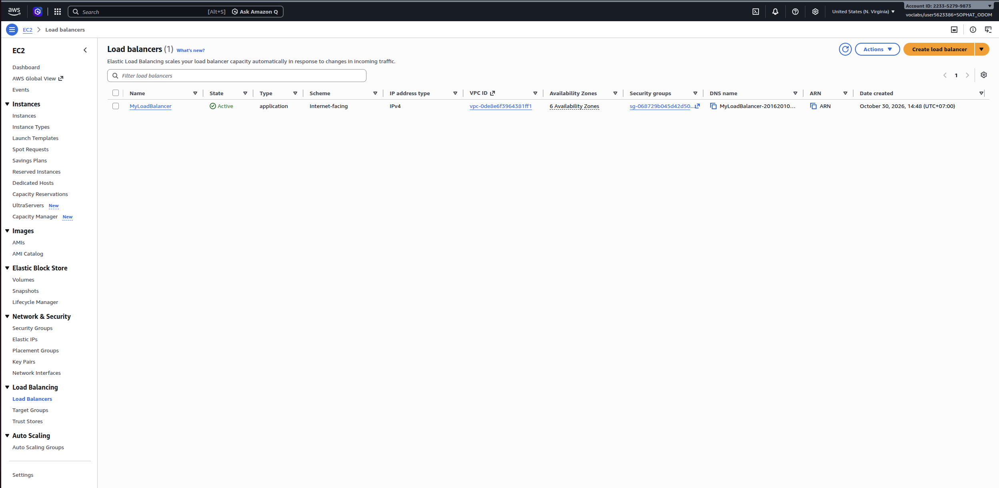

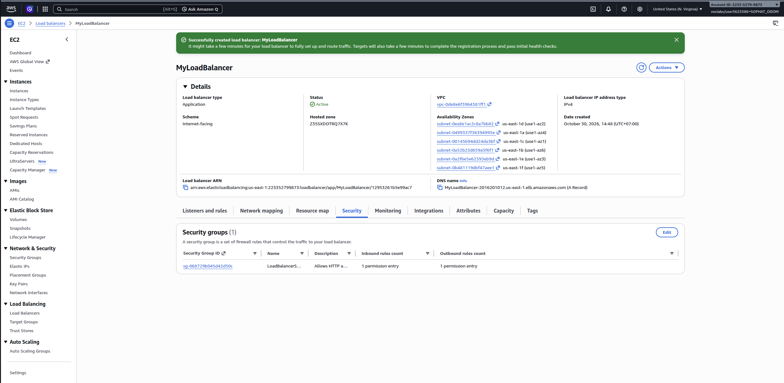

## Launch template

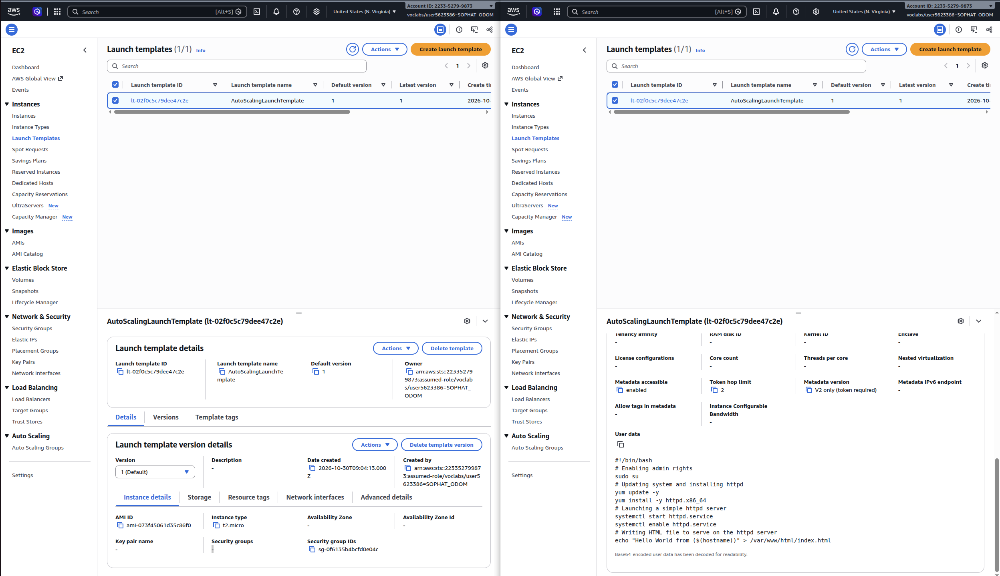

## Auto Scaling group

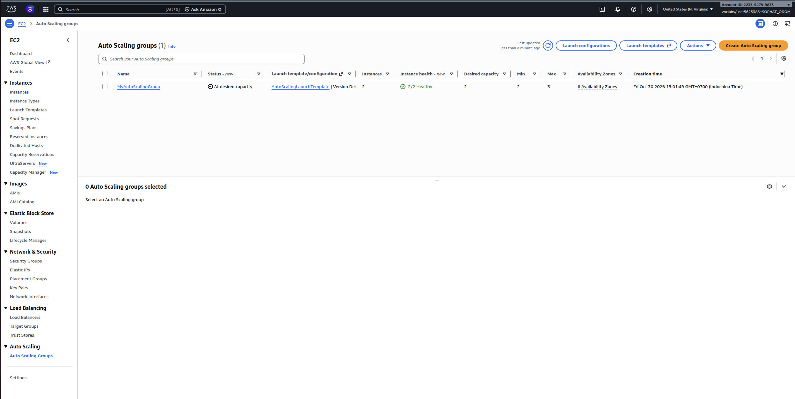

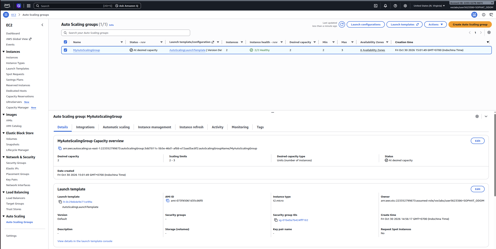

## Load balancing test

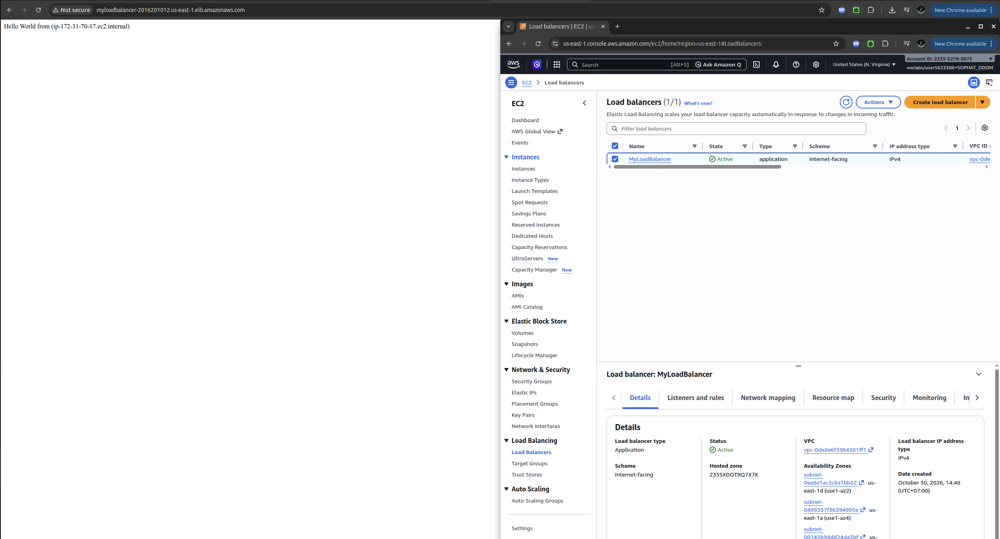

## Simulated application failure

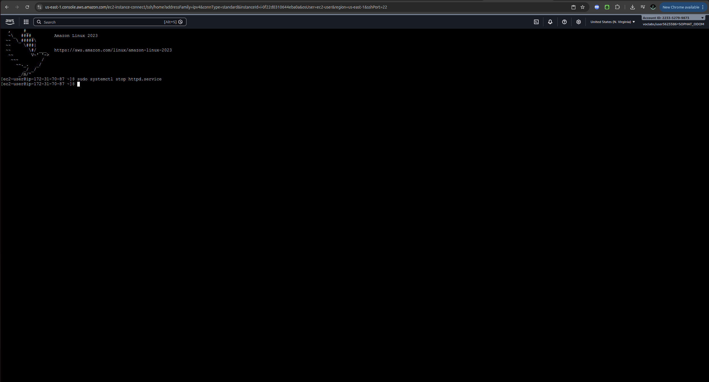

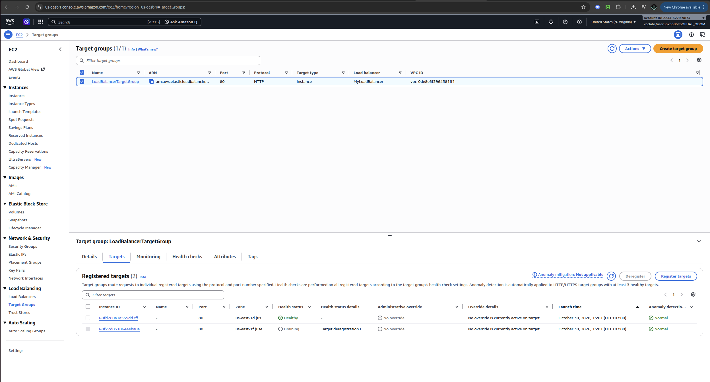

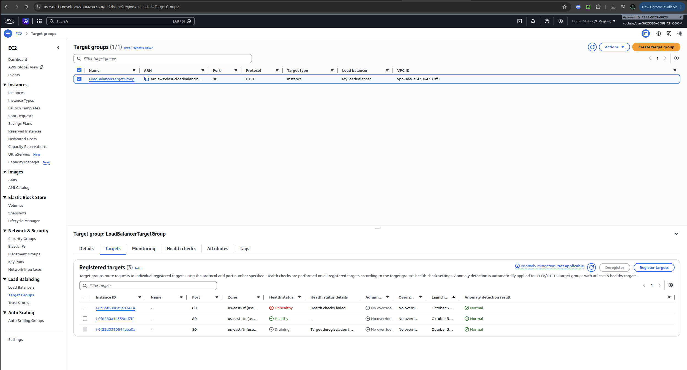

About how many minutes passed between stopping `httpd` and the new instance becoming healthy?
* About 2 minutes

---

## Questions

1. Why does the page show a different host name when you refresh it?  
* The load balancer distributes requests between the two EC2 instances. Each instance displays its own host name, so the name can change when a different instance handles the request. It does not necessarily change on every refresh.  
2. After you stopped `httpd`, the instance was still *running* in EC2, but the target group marked it *unhealthy*. What did the health check test, and why did the instance fail it?  
* The health check requested / through HTTP on port 80 and expected a 200 OK response. After I stopped httpd, the web server could no longer respond. After two consecutive failed checks, the target was marked unhealthy even though the EC2 instance was still running.  
3. Who replaced the failed instance: the load balancer, the target group, or the Auto Scaling group? Explain the role of each one.  
* The Auto Scaling group replaced it because Elastic Load Balancing health checks were enabled. The load balancer forwards requests to healthy instances. The target group holds the registered instances and their health check settings and status. The Auto Scaling group terminates unhealthy instances and launches replacements to maintain the desired capacity.  
4. With desired 2, minimum 2 and maximum 3, how many instances run normally? In what situation could there be 3?  
* Normally, 2 instances run because the desired capacity is 2. There could be 3 if I manually increased the desired capacity to 3 or configured a scaling policy to add an instance when demand increased. Setting the maximum to 3 alone does not enable automatic scaling based on traffic.  
5. The instances' security group allows HTTP from anywhere. How could you change it so that the instances accept HTTP **only** from the load balancer?  
* In LaunchTemplateSecurityGroup, I would change the HTTP port 80 rule’s source from 0.0.0.0/0 to the security group ID of LoadBalancerSecurityGroup. This allows HTTP traffic from the load balancer instead of directly from anyone on the internet.  

## Problems and how I solved them (optional)

## AI note (optional)

One suggestion an AI tool gave you and how you checked it.

## Clean up

- [x] `MyAutoScalingGroup` deleted and its instances terminated.
- [x] `AutoScalingLaunchTemplate` deleted.
- [x] `MyLoadBalancer` and `LoadBalancerTargetGroup` deleted.
- [x] Both security groups deleted.