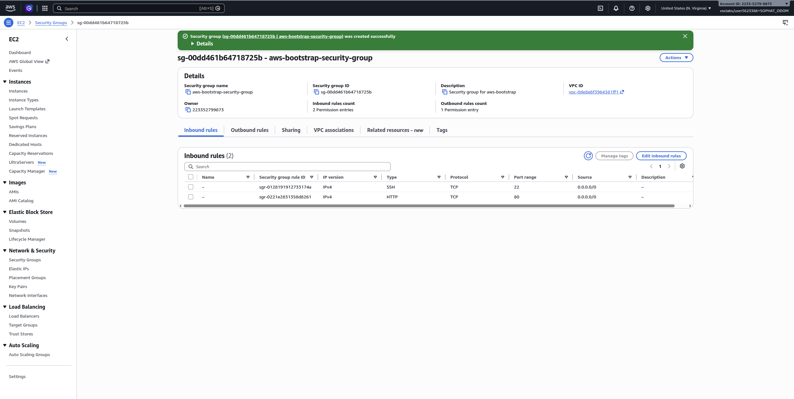
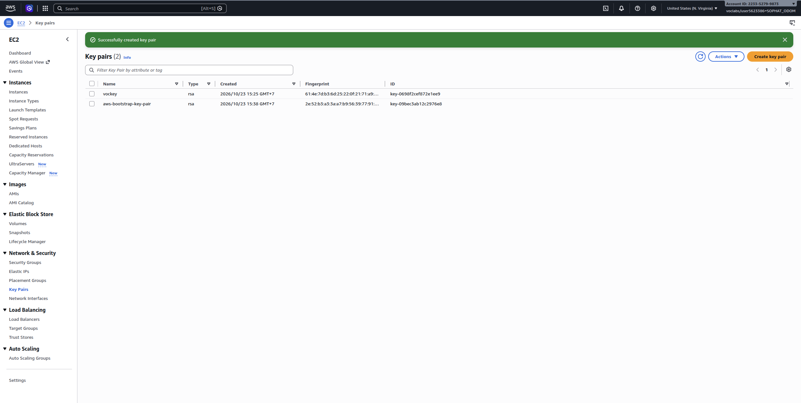
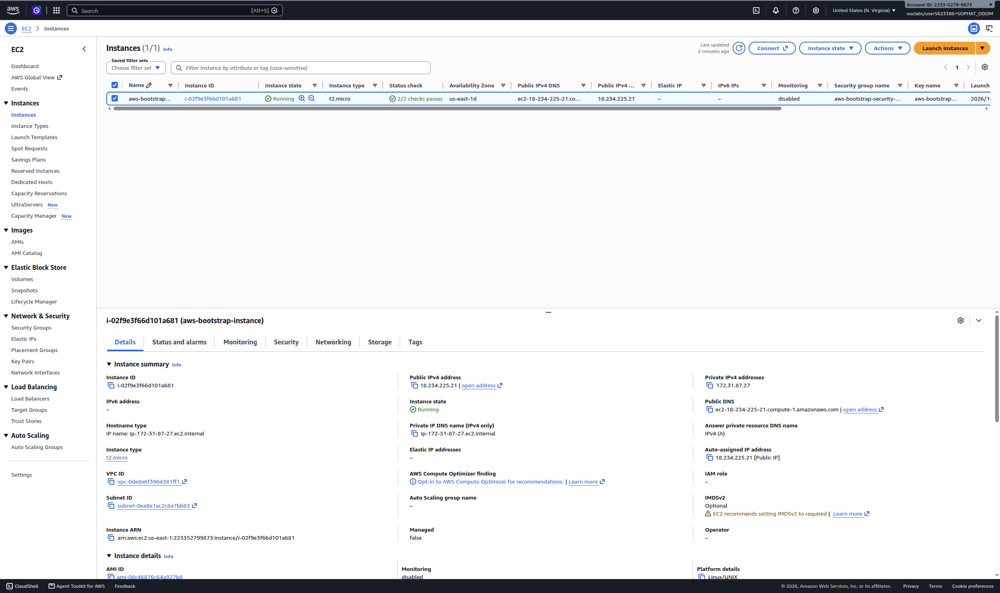
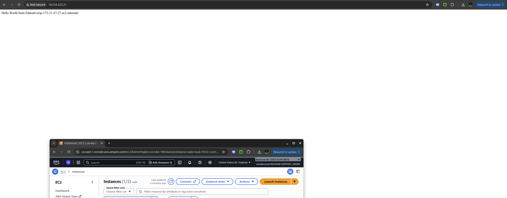
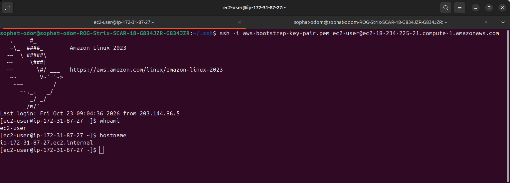
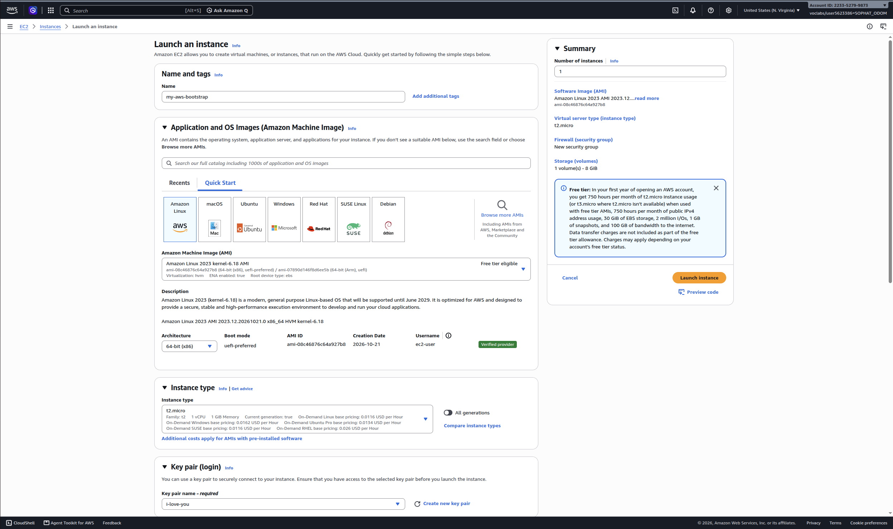
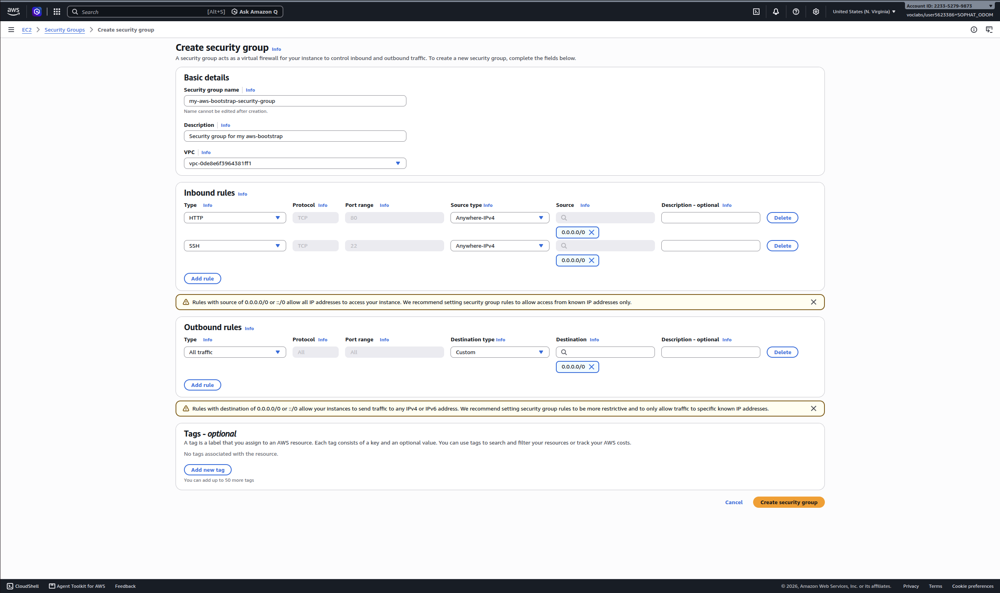
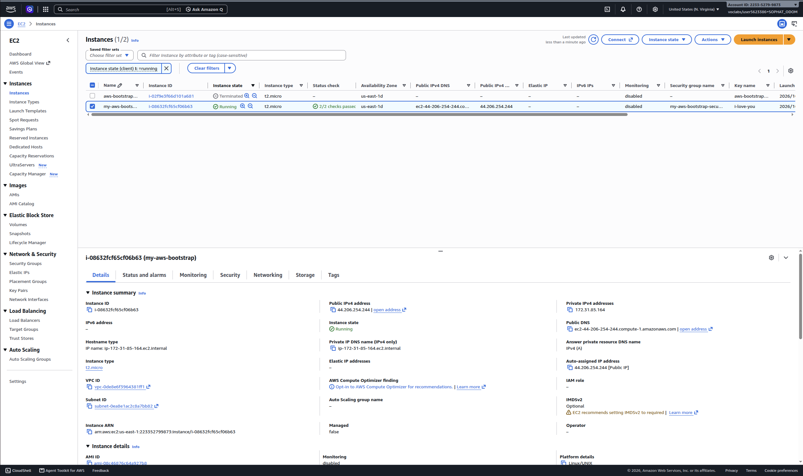
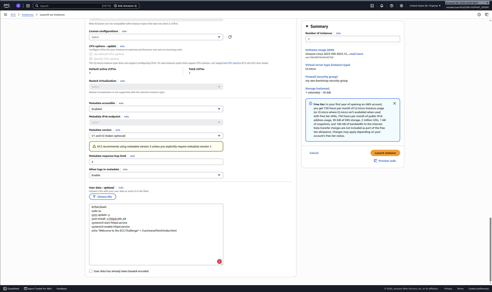
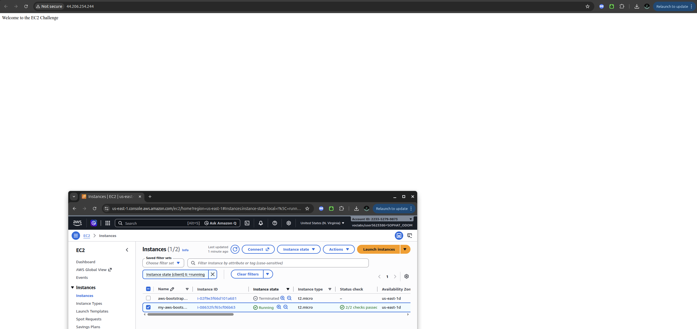

# Cloud Lab 1 Submission — Amazon EC2

Copy this template to `cc-lab-YOUR_ID/lab1/README.md` in your own repository. Follow [the instructions](lab1-instruction.md). Put your screenshots in `lab1/images/` with the file names below.

- **Student name: Sophat Odom**
- **Student ID: e20221559**
- **Learner Lab user name: Sophat Odom**
- **Date completed: Fri 23 Oct 2026**

---

## Part 1.1 — An Amazon EC2 Walkthrough

### Security group



### Key pair



### Instance details



### Browser test



### SSH connection



Did you connect with your own SSH client or with EC2 Instance Connect?

---

## Part 1.2 — EC2 Web Solution (Challenge)

### Launch configuration



### Security group



### Running instance



### Commands on the instance



Paste the commands you ran to install the web server and create `index.html`:

```bash

```

### Browser test



---

## Questions

1. Your security group has an SSH rule and an HTTP rule. What does each one let you do? What would stop working if you deleted the HTTP rule?
* SSH rule: Allows command-line management via port 22.
* HTTP rule: Allows public web traffic access via port 80.
* If deleted: The web browser test will fail to load the site, but SSH access will remain functional.

2. In Part 1.1 you never logged in to install the web server. What installed it, and when did it run?
* It was installed by the shell script pasted into the User data field under Advanced details. It ran automatically during the instance's initial boot up phase.

3. Why does the web page open with `http://` but not with `https://`?
* The instance lacks an SSL/TLS certificate, and HTTPS (Port 443) is not permitted in the Security Group inbound rules.

4. Part 1.2 asked for a 10 GiB root volume. Where in the launch settings did you set it, and how can you check the size on the running instance?
* Launch settings: Configured in the Configure storage panel by changing the size from 8 GiB to 10 GiB.
* Running instance: Verified by running the lsblk or df -h command in the terminal **or** verified in the AWS Console by selecting the instance, opening the Storage tab at the bottom, and checking the Volume size column.

## Problems and how I solved them (optional)

## AI note (optional)

One suggestion an AI tool gave you and how you checked it.

## Clean up

- [x] Part 1.1: instance terminated, key pair and security group deleted.
- [x] Part 1.2: instance terminated, security group (and key pair, if any) deleted.